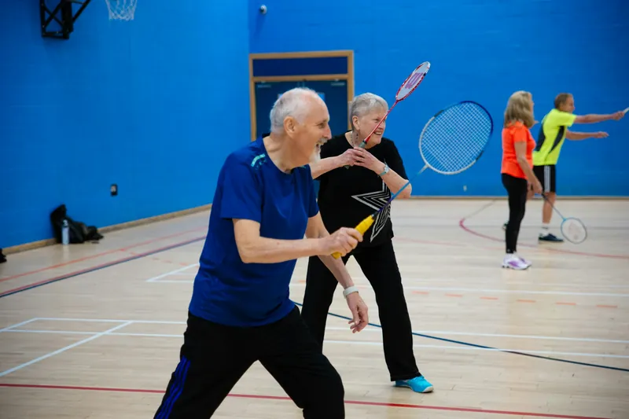
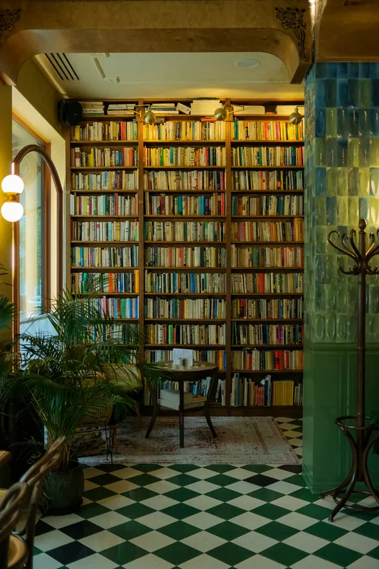

# Thymewood component guide (for page builders)

Brand: **Thymewood Garden Residence** (fictional). 14 Orchard Lane, Stamford PE9 2TW · 01632 960 412 ·
hello@thymewood.example · visiting every day 9:00 to 20:00 · family-run since 1994 · 64 residents · 2 acres of walled
gardens · registered nurses 24/7.

Rules
- Edit ONLY your page's `<main>` content, `css/pages/<page>.css` and `js/pages/<page>.js`. Do not edit
  `css/site.css`, `js/site.js`, `js/validation.js`, the header, the footer or the hero block of your page.
- Replace the `<!-- PAGE CONTENT -->` comment and fill the placeholder sections (keep their ids).
- Photos: only those assigned to your page in `images/ASSIGNMENT.md`. Every `` needs `alt`, real `width`/`height`,
  `loading="lazy"` (below the fold). Images always sit in a fixed-aspect frame with `object-fit: cover` (all the frames
  below already do this).
- Fonts: Literata (headings), Atkinson Hyperlegible (body, 18px). Nothing under 16px. Use tokens (`var(--muted)`, etc.).
- Copy voice: warm, personal, plain words ("your mum", "we will show you round"), fictional names only.
- One deep forest-green band (`.band`) per page. Alternate `.section`, `.section--tint`, `.section--sand` otherwise.
- Every link goes to its own destination; on-page anchors must match an existing id.
- Run `node tests/qa.cjs .` from the project folder before you report (see README).

Tokens worth knowing: `--ink`, `--muted`, `--leaf` (CTA), `--leaf-ink` (links/icons), `--surface`, `--bg`, `--tint`,
`--sand`, `--line`, `--sage-soft`, `--r-sm/md/lg/pill`, `--s1…--s9`, `--section-y`, `--fs-h2/h3`.
Dark theme and RTL are automatic if you use tokens and logical properties (`margin-inline`, `inset-inline-start`,
`text-align: start`). Arrow icons get `class="flip"` so they mirror in RTL.

---

## Layout

```html
<section class="section" id="…" aria-labelledby="x-title">       <!-- also: section--tint, section--sand, section--tight, band -->
  <div class="container"> … </div>                                  <!-- container-narrow too: 860px -->
</section>
```

### Section intro (eyebrow → heading → paragraph, one stacked block)
```html
<header class="intro intro--center">            <!-- drop intro--center for start-aligned -->
  <p class="eyebrow">Our facilities</p>
  <h2 id="x-title">Rooms that feel like home, not a ward</h2>
  <p>One or two sentences directly under the heading.</p>
</header>
```
Centred notes under centred content: `<p class="note note--center">…</p>`. Button row under a section:
`<div class="section-actions">…</div>`.

### Deep forest-green band (ONE per page)
`<section class="section band" …>`: headings/text/eyebrows/badges/buttons/roman-list recolour automatically.

### Split (image + text)
```html
<div class="split">                              <!-- split--reverse puts the image on the end side -->
  <div class="split-media"></div>
  <!-- split-media--tall (4/5) for portrait photos -->
  <div class="split-body">
    <p class="eyebrow">…</p><h2>…</h2><p>…</p>
    <ul class="checklist"><li>…</li><li>…</li></ul>
    <a class="btn btn-primary" href="…">…</a>
  </div>
</div>
```

### Buttons & links
- Primary CTA (the ONLY CTA style): `<a class="btn btn-primary" href="contact.html#book">Book a Visit</a>`; add `btn-lg`
  for hero/CTA band size, `btn-block` for full width.
- Secondary: `<a class="btn btn-secondary" href="…">…</a>`.
- Text link with arrow (used as the last row of cards):
  `<a class="link" href="…">View the suites <svg class="flip" viewBox="0 0 24 24" width="18" height="18" aria-hidden="true"><path d="M5 12h14M13 6l6 6-6 6"/></svg></a>`

### Badge and meta line
```html
<span class="badge">Accommodation</span>          <!-- badge--honey = warm variant -->
<ul class="meta">                                   <!-- small icons + text under a hairline rule -->
  <li><svg viewBox="0 0 24 24" width="18" height="18" aria-hidden="true">…</svg>28 m²</li>
  <li><svg …>…</svg>En-suite</li>
</ul>
```

### Stats strip (round bullets, centred)
`<ul class="stats"><li><strong>4.9 / 5</strong> family rating</li><li>…</li></ul>` (becomes a 2 x 2 grid on phones).

### Icon list (contact details)
`<ul class="icon-list"><li><svg …/><span>…</span></li></ul>`

### In-page sub-navigation (centred chips, NOT sticky)
`<nav class="subnav" aria-label="On this page"><a href="#suites">Suites</a>…</nav>` (has its own top margin; put it
inside a `.container` after the hero, before the first section).

---

## Cards with subgrid (text rows always level)

Container: `<div class="cards cards--3">` (`cards--2`, `cards--3`, `cards--4`).
Columns: `cards--4` 4 cols ≥1200px, 2 cols 640–1199, 1 col <640. `cards--3` 3 cols ≥1024, horizontal one-per-row at
640–1023, stacked <640. `cards--2` 2 cols ≥768, 1 col below.

Each `.card` spans `--rows` rows of the parent grid with `grid-template-rows: subgrid`, so row *k* of every card in a
visual row shares one track: badges, titles, texts, meta lines and links line up even when a title wraps.
**A card must have exactly `--rows` direct children, in the same order, in every card of the row** (default 6).
Use `card--rows-3/4/5/6/7` (or `style="--rows:N"`) when you have a different number of children. Don't wrap the
children in an extra div, don't skip a child in one card (use the same structure in all cards of the row).

### Standard image card: 6 rows (media / badge / title / text / meta / link)
```html
<div class="cards cards--3">
  <article class="card">
    <div class="card-media"></div>
    <span class="badge">Dining</span>
    <h3 class="card-title">The Orchard Dining Room</h3>
    <p class="card-text">…</p>
    <ul class="meta"><li><svg …/>3 meals daily</li></ul>
    <a class="link" href="facilities.html#dining">See the menus <svg class="flip" …/></a>
  </article>
  …
</div>
```
Frames: `card-media` 3/2 (default), `card-media--tall` 4/5 (portrait photos, e.g. team), `card-media--square`.
Optional rows you may use instead: `<div class="card-kicker"><span class="badge">…</span><time datetime="…">…</time></div>`
(badge + date on one row), `<p class="price">…</p>`, `<a class="btn btn-primary">` as last row.

### Card without image (icon card): e.g. 4 rows (icon / title / text / link)
```html
<article class="card card--rows-4">
  <span class="card-icon"><svg viewBox="0 0 24 24" aria-hidden="true">…</svg></span>
  <h3 class="card-title">Call us</h3>
  <p class="card-text">…</p>
  <a class="link" href="tel:+441632960412">01632 960 412</a>
</article>
```

### Horizontal card (image beside text): 5 text rows + media spanning them
For 2-up rows: `<div class="cards cards--2">` + `<article class="card card--h">` with children
`card-media`, `badge`, `card-title`, `card-text`, `meta`, `link` (media spans all text rows; `--rows` = 5 = text
children only). Below 1024px the same markup becomes a normal vertical 6-row card automatically (2 columns at
768–1023, 1 column below). Home 1 "care services" uses this.

### Team / person card (About): 5 rows
`<article class="card card--rows-5">` with `card-media card-media--tall` (portrait `-800`), `badge` (department),
`card-title` (name), `card-text` (one-line bio), `meta` (e.g. "With us since 2009").

### Blog card: 6 rows (cover / kicker / title / excerpt / author / link)
QA requires `.blog-card`, `img.blog-cover`, `.author-name`, `img.author-photo`.
```html
<article class="card blog-card" id="post-2">
  <div class="card-media"></div>
  <div class="card-kicker"><span class="badge">Staying active</span><time datetime="2026-09-30">30 Sep 2026</time></div>
  <h3 class="card-title">Small movements, big gains: staying active after eighty</h3>
  <p class="card-text">…</p>
  <div class="author">
    
    <span class="author-text"><span class="author-name">Hannah Doyle</span><span class="author-role">Activities Coordinator</span></span>
  </div>
  <a class="link" href="#post-2-full">Read article <svg class="flip" …/></a>
</article>
```
(Home 1 teasers use `<span class="author-initials" aria-hidden="true">HD</span>` instead of the photo, so author photos
appear only on the blog page.) Blog grid: 6 cards in `cards cards--3` = 3 x 2, no orphan.

---

## Roman-numeral list (numeral + heading on one line, fixed numeral column)
2 columns ≥900px; each item spans 2 subgrid rows (heading row, text row), so text starts level across a row.
```html
<ol class="roman-list">
  <li><span class="numeral" aria-hidden="true">I</span><h3>Dignity before routine</h3><p>…</p></li>
  <li><span class="numeral" aria-hidden="true">II</span><h3>…</h3><p>…</p></li>
</ol>
```
Exactly 3 children per `li`. Inside `.band` it recolours (honey numerals).

## Vertical centred timeline (alternating on desktop, single column <768px)
```html
<ol class="timeline">
  <li><time class="tl-year" datetime="1994">1994</time><h3>The first house</h3><p>…</p></li>
  <li><time class="tl-year" datetime="2003">2003</time><h3>…</h3><p>…</p></li>
</ol>
```

## Testimonials (one quote icon, photo, bold name + muted "Role, Relationship")
`<div class="testimonials">` = 3 columns ≥1024px (subgrid: quote / words / person rows level), one column below.
`testimonials testimonials--2` for two. Each card spans 3 rows: exactly 3 children.
```html
<div class="testimonials">
  <figure class="testimonial">
    <svg class="t-mark" viewBox="0 0 24 24" width="40" height="40" aria-hidden="true"><path d="M10 7c-3.3 0-6 2.7-6 6v5h6v-6H7c0-1.7 1.3-3 3-3V7zm10 0c-3.3 0-6 2.7-6 6v5h6v-6h-3c0-1.7 1.3-3 3-3V7z"/></svg>
    <blockquote><p>Words without typographic quote marks.</p></blockquote>
    <figcaption>
      
      <span class="t-person"><span class="t-name">Joan Whitfield</span><span class="t-role">Retired florist, Resident</span></span>
    </figcaption>
  </figure>
</div>
```

## FAQ accordion (native details; group questions)
```html
<div class="faq">
  <div class="faq-group">
    <h3>Visiting</h3>
    <div class="faq-list">
      <details class="faq-item" name="faq-visiting">
        <summary><span class="faq-q">Can I visit at any time?</span><span class="faq-icon" aria-hidden="true"><svg viewBox="0 0 24 24" width="18" height="18"><path d="M6 9l6 6 6-6"/></svg></span></summary>
        <div class="faq-answer"><p>…</p></div>
      </details>
    </div>
  </div>
</div>
```

## Forms (validated by js/validation.js automatically)
```html
<div class="form-card">
  <form class="form" data-validate novalidate data-success-message="Thank you, Daniel will call you within one working day.">
    <div class="form-grid">
      <div class="field">
        <label for="bk-name">Your name <span class="req" aria-hidden="true">*</span></label>
        <input id="bk-name" name="name" type="text" autocomplete="name" required>
      </div>
      <div class="field">
        <label for="bk-email">Email <span class="req" aria-hidden="true">*</span></label>
        <input id="bk-email" name="email" type="email" autocomplete="email" required>
      </div>
      <div class="field">
        <label for="bk-phone">Phone <span class="req" aria-hidden="true">*</span></label>
        <input id="bk-phone" name="phone" type="tel" inputmode="tel" autocomplete="tel" required>
        <p class="field-hint" id="bk-phone-hint">Digits only, 7 to 15.</p>          <!-- optional; add aria-describedby="bk-phone-hint" -->
      </div>
      <div class="field">
        <label for="bk-date">Preferred date <span class="req" aria-hidden="true">*</span></label>
        <input id="bk-date" name="date" type="date" required>                         <!-- not in the past -->
      </div>
      <div class="field field--full">
        <label for="bk-msg">Anything we should know?</label>
        <textarea id="bk-msg" name="message"></textarea>
      </div>
      <div class="field field--full">
        <label class="check"><input type="checkbox" name="consent" required> I agree to be contacted about my visit.</label>
      </div>
    </div>
    <div class="form-actions"><button class="btn btn-primary btn-lg" type="submit">Book my visit</button></div>
    <p class="form-success" data-form-success role="status" hidden>
      <svg viewBox="0 0 24 24" aria-hidden="true"><circle cx="12" cy="12" r="9"/><path d="m8 12 3 3 5-6"/></svg>
      <span data-success-text>Thank you. We will be in touch soon.</span>
    </p>
  </form>
</div>
```
Rules come from the field: `name` → ≥2 letters, letters/spaces/'-. only, no digits; `email`/`type=email` → standard
format; `phone`/`type=tel` → digits (spaces and a leading + allowed), 7–15 digits; `type=date` → today or later
(`min` set automatically). Override with `data-rule="name|email|phone|future-date|required"`. Empty optional fields are
valid; `required` makes them mandatory (checkbox must be ticked; selects need a non-empty value, so give the
placeholder option `value=""`). Errors appear as `<p class="field-error" id="<id>-error">` inside the `.field`, with
`aria-invalid` and `aria-describedby` managed for you. Success: the `[data-form-success]` box is shown, the form
resets, and a `form:success` event fires on the form.

## Gallery
```html
<div class="gallery">                                  <!-- 3 cols ≥900, 2 cols, 1 col <480 -->
  <figure class="gallery-item gallery-item--tall"><figcaption>Library</figcaption></figure>
  <figure class="gallery-item gallery-item--wide"><figcaption>…</figcaption></figure>
  <figure class="gallery-item"></figure>
</div>
```
Portrait photos only in `gallery-item--tall`. Never two [CH] photos next to each other.

## CTA band
```html
<section class="section">
  <div class="container">
    <div class="cta-band">
      <p class="eyebrow">Come and see us</p>
      <h2>Come for tea and see Thymewood for yourself</h2>
      <p>…</p>
      <div class="hero-ctas">
        <a class="btn btn-primary btn-lg" href="contact.html#book">Book a Visit</a>
        <a class="btn btn-secondary btn-lg" href="tel:+441632960412">Call 01632 960 412</a>
      </div>
    </div>
  </div>
</section>
```

## Heroes (already in your shell: do not change size or structure)
- Home variant (`index.html`, `home-2.html`): `.hero` > `img.hero-bg` + `.hero-shade` + `.hero-content`
  (`eyebrow eyebrow-pill`, `h1`, `p.hero-lead`, `.hero-ctas` max 2 buttons, optional `ul.stats`).
- Inner pages: `.page-hero` > `img.page-hero-bg` + `.hero-shade` + `.page-hero-content` (crumbs, `h1`, one-line `p`).

## Misc
- `.sr-only` (visually hidden), `.ltr-num` (keep phone numbers LTR inside RTL), `.reveal` (opt-in fade-in; don't use on
  card rows or controls).
- Header/footer behaviour (theme, RTL, dropdown, mobile menu, year, anchor offset) is in `js/site.js`; nothing to do.
